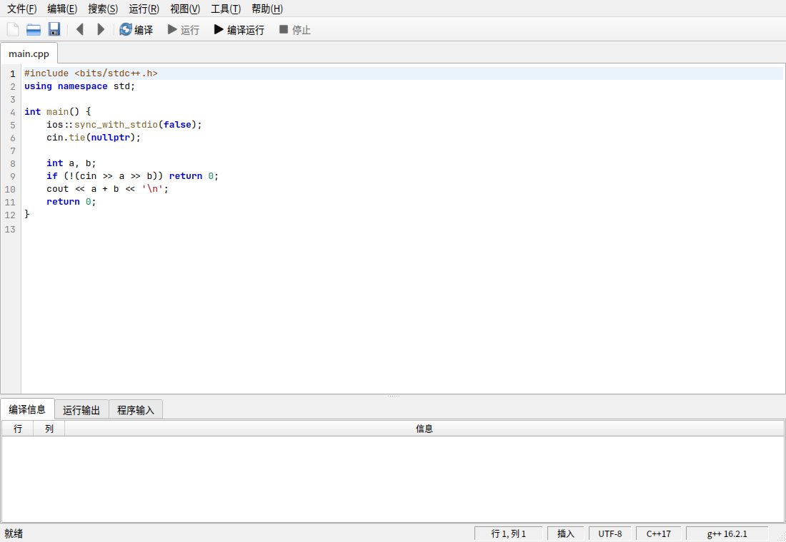
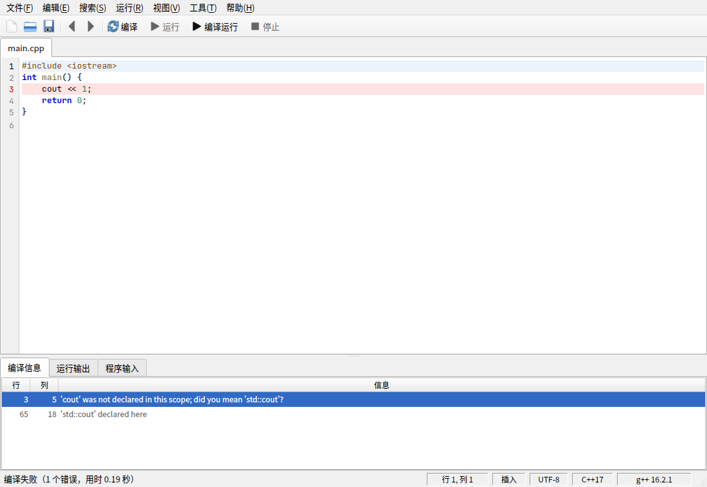
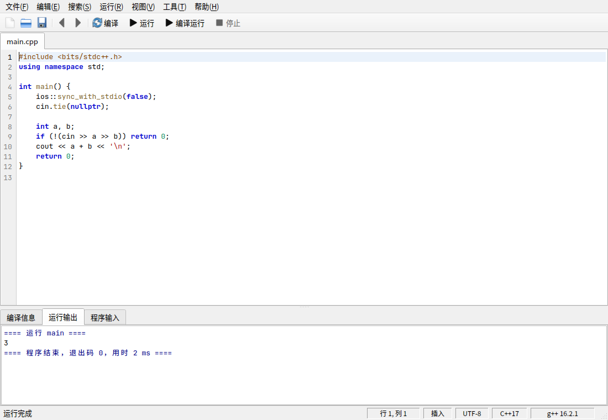

# Aplus

> 代码作者：**DeepSeek AI**

Aplus 是一个用 C++17 + Qt 6 写的单文件 C++ 编辑器，布局按 Dev-C++ 的经典样式：
菜单栏、工具栏、编辑区、底部编译信息/运行输出、状态栏。界面全部用 Qt 原生控件和标准图标，
没有自绘的外框和网页那一套。运行默认像 Dev-C++ 一样，单独开一个控制台窗口。



## 功能

- 编辑：C++ 语法高亮、行号、当前行高亮、自动缩进、Tab 缩进、`Ctrl+/` 注释、`Ctrl+滚轮` 缩放字号
- 编译：F9；运行：F10；编译并运行：F11；停止：Ctrl+F2
- 编译信息用表格显示，双击错误行跳到源码对应位置，出错行标红
- 运行默认打开独立控制台窗口（Linux 走 GNOME Console 等，Windows 走 PowerShell），程序结束后显示退出码并等按键；也可以切回内嵌输出
- “题目”标签页：输入洛谷 P1001 / Codeforces 1926C 拉题面和样例，样例一键填入输入框，按题号建文件
- “程序输入”标签页用来给控制台程序喂 stdin，留空则可以在控制台里手动输入
- 内嵌输出模式会实时显示 stdout/stderr，stderr 标红
- 编译选项：C++11/14/17/20/23、-O0 ~ -O3、-Wall、时间限制
- 文件：新建、打开、保存、另存为
- 生成的程序放在源文件旁边（Windows 下是 `.exe`），和 Dev-C++ 的习惯一致

| 编译错误 | 内嵌输出模式 |
| --- | --- |
|  |  |

## 运行方式

默认按 Dev-C++ 的方式运行：F11 编译完成后弹出一个独立的终端窗口，程序输出和键盘输入都在
那个窗口里；程序结束时显示

```
----------------------------------------
Process exited after 3 ms with return value 0.
按任意键关闭窗口...
```

- 控制台直接调用 GNOME Console（`kgx`）；找不到时再试 `gnome-terminal`、`konsole`、`xfce4-terminal`，都没有就回退到内嵌输出。
- 运行菜单里的“在独立控制台中运行”可以取消勾选，切回底部内嵌输出。
- “程序输入”里有内容时，会作为程序的标准输入；留空就可在控制台窗口里手动输入，`Ctrl+C` 可直接中断程序。
- 独立控制台模式不套 OJ 的时间限制，死循环用 `Ctrl+F2` 停止；内嵌输出模式仍按设置的时间限制判 TLE。

## Arch 上编译运行

```bash
sudo pacman -S --needed base-devel cmake ninja qt6-base
cmake -S . -B build -G Ninja
cmake --build build
./build/aplus
```

`g++` 来自 `base-devel`。如果编译器不在 PATH 里，可以用环境变量指定：

```bash
GXX=/path/to/g++ ./build/aplus
```

## 快捷方式

```bash
./install-shortcut.sh
```

脚本会把桌面入口装到 `~/.local/share/applications/aplus.desktop`，并在有桌面目录时放一份
`~/Desktop/Aplus.desktop`。之后在 GNOME 活动里搜索 **Aplus** 就能启动。

快捷方式指向 `build/aplus`，工作目录是项目根目录；项目搬家后重新执行一次脚本即可。

## Ubuntu 上编译运行

```bash
sudo apt install build-essential cmake ninja-build qt6-base-dev
cmake -S . -B build -G Ninja -DCMAKE_BUILD_TYPE=Release
cmake --build build
./build/aplus
```

22.04 / 24.04 都行（Qt >= 6.2），细节见 [docs/UBUNTU.md](docs/UBUNTU.md)。

## 编译成 Windows exe

代码是跨平台的，Windows 上重新编译一遍即可，不用改源码。完整步骤见
[docs/WINDOWS.md](docs/WINDOWS.md)：装 MSYS2（UCRT64）或者 Qt 官方安装器的 MinGW 套件，
两条命令编译，`windeployqt` 打包，产物是 `build/aplus.exe`。

Windows 版功能是齐的：独立控制台用 PowerShell 开一个新的控制台窗口跑程序，
F9/F10/F11、时间限制、错误跳转、Ctrl+滚轮、图标都一样。

## 使用

默认打开 `workspace/main.cpp`。新建工作区时里面是 A+B 模板，“程序输入”里预置了 `1 2`。
按 **F11** 编译并运行：控制台窗口里会显示结果，IDE 底部的“运行输出”只记录运行状态：

```
==== 在独立控制台中运行 main ====
（标准输入取自“程序输入”标签页）
==== 程序结束，退出码 0，用时 3 ms ====
```

编译报错时切到“编译信息”，双击某一行会跳到编辑器对应行；红色行号表示第一个错误。

## 快捷键

| 快捷键 | 功能 |
| --- | --- |
| `F9` | 编译 |
| `F10` | 运行上次编译的程序 |
| `F11` | 编译并运行 |
| `Ctrl+F2` | 停止 |
| `Ctrl+S` / `Ctrl+Shift+S` | 保存 / 另存为 |
| `Ctrl+F` / `F3` | 查找 / 查找下一个 |
| `Ctrl+G` | 转到行 |
| `Ctrl+/` | 注释或取消注释 |
| `Ctrl+滚轮` | 缩放代码字号（6–48 pt） |

## 目录结构

```
aplus/
├── CMakeLists.txt
├── src/
│   ├── main.cpp              # QApplication、Fusion 风格、启动
│   ├── mainwindow.cpp/.h     # 菜单、工具栏、编辑区、编译信息、状态栏
│   ├── codeeditor.cpp/.h     # QPlainTextEdit + 行号 + 自动缩进
│   ├── highlighter.cpp/.h    # C++ 语法着色
│   └── compilerunner.cpp/.h  # g++ 编译、运行、时限、停止
├── tests/
│   └── test_compilerunner.cpp
├── workspace/
│   └── main.cpp
└── docs/
```

## 测试

```bash
ctest --test-dir build --output-on-failure
```

或者直接运行 `./build/compilerunner_tests`。测试覆盖编译运行、编译错误、超时、退出码、stderr 和手动停止。

## 说明

- 独立控制台：Linux 用 GNOME Console / 其他终端模拟器，Windows 用 PowerShell 开控制台窗口；
  两边都是“壳脚本 + status 文件”的同一套做法。找不到可用终端时回退到内嵌输出。
- 没有调试器，按你的要求先不做。
- 一次编译一个源文件，没有多文件项目。
- 编译错误信息是英文（编译时设置了 `LC_ALL=C`），和 OJ 一致。
- 程序输出超过约 2 万行时，较早的内容会被截掉，避免界面卡死。
